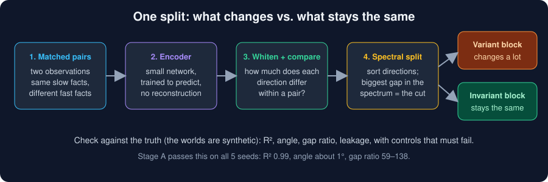
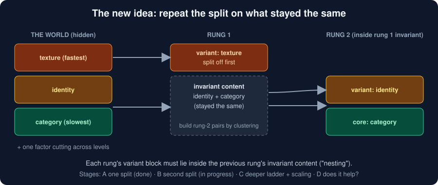
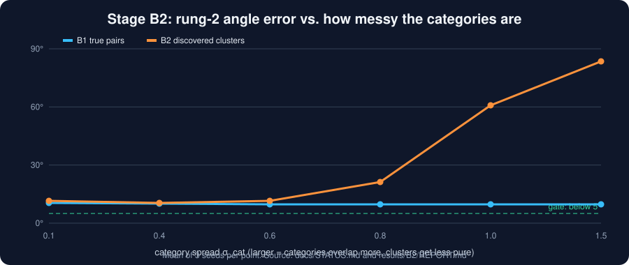

# Iterative-Split-JEPA

**Can a model learn to separate "what changes" from "what stays the same", and then do it again on the part that stayed?**

Iterative-Split-JEPA extends *SplitJEPA*, a method that splits a learned representation into a fast-changing (variant) part and a slow-changing (invariant) part without reconstructing the input. Here the split is applied **repeatedly**, giving a ladder of layers from fast to slow (for example texture → identity → category). This repository is a controlled, pre-registered test of that idea on synthetic worlds where the ground truth is known.

> **Status: research in progress.** Stage A (one split) passes. Stage B (the second split) works in clean worlds but misses several of its own pre-set gates, and the repository reports those misses openly. Stages C and D are not started.



## The idea in one minute

A world has hidden facts. Some change fast (lighting, texture), some slowly (which object it is, its category). We only see scrambled observations. Given **matched pairs** (two observations that share the slow facts but differ in the fast ones), the method:

1. trains a small encoder to predict across the pair, with no reconstruction;
2. whitens the representation and measures how much each direction differs within a pair;
3. cuts the sorted spectrum at its largest gap into a **variant** block (changes a lot) and an **invariant** block (stays the same).

Because the worlds are synthetic, every claim is scored against the truth: R², the angle to the true subspace, the gap ratio, and leakage between blocks. Controls that *should* fail (shuffled pairs, no prediction, no whitening) must fail.



## Results so far

| Stage | Question | Status | Result |
| --- | --- | --- | --- |
| **A** | Does one split work with a trained encoder? | Done, passes | All 5 seeds meet every pre-set criterion: invariant R² about 0.99, angle about 1°, gap ratio 59–138, no leakage. Controls fail as required. |
| **B1** | Can the invariant part be split a second time (true pairs)? | Done, partial | Rung 1 passes. Rung 2 angle is about 10° against a 5° gate. |
| **B2** | Same, with pairs built by clustering (no labels) | Done, partial | Matches B1 on angle, but rung-2 gap ratio is 3.1 against a gate of 10, and leakage is above its bound. Degrades sharply once clusters overlap (chart below). |
| **C** | Deeper ladder and 1/√n scaling | Not started | |
| **D** | Does it help downstream? | Not started | |



What the B2 work found (details in [`results/B2/REPORT.md`](results/B2/REPORT.md) and [`docs/P9_REPORT.md`](docs/P9_REPORT.md)):

- The rung-1 error is an **encoder-bias floor** (3–4.7° at every data budget), so more rung-1 pairs do not help.
- Much of the 10° "nesting" error is a **measurement-definition gap**; against the orthogonal-complement reference it is 2.2–3.3°.
- Purifying the clustered pairs lifts the rung-2 gap ratio from 3.1 to about 19 (recovering about 64% of the B1–B2 deficit), but rung-2 angle, texture R² and leakage still miss their gates.
- Results come from 3 seeds in a clean world, so treat them as preliminary.

## Quick start

```bash
pip install -e '.[dev]'
pytest -q                                                    # algebraic core, seconds
python experiments/run_stage_a.py --out runs/stage_a/my_run  # about 1 minute per run on CPU
```

Use `OMP_NUM_THREADS=1` when running several seeds in parallel.

## Repository map

| Path | What is in it |
| --- | --- |
| `src/isj/worlds.py` | Synthetic worlds: block-diagonal Gaussian blocks, correspondence families, coupling map |
| `src/isj/encoder.py` | Reconstruction-free encoder (predictive loss plus variance/covariance regulariser) |
| `src/isj/engine.py` | ZCA whitening, difference moments, spectral split, gap rule, iterated ladder |
| `src/isj/audits.py` | Principal angles, leakage with permutation null, nesting and rank tests |
| `src/isj/stage_a.py`, `stage_b1.py`, `stage_b2*.py` | Pipelines for each stage |
| `configs/` | Stage configs; success criteria are hash-frozen (`*.sha256`) |
| `experiments/` | Runners and report builders |
| `runs/`, `results/` | Recorded raw results (immutable JSON), reports and figures |
| `tests/` | Unit tests for the core, nesting enforcement, clustering, logging |
| `explog/` | Append-only, hash-chained experiment log (`python -m isj.explog verify`) |

## Documentation

Start here, in this order:

1. [`docs/experiment_walkthrough.md`](docs/experiment_walkthrough.md): plain-English plan, glossary, and what each stage tests.
2. [`docs/stage_a_results.md`](docs/stage_a_results.md): the Stage A record, including debug rounds and controls.
3. [`results/B2/REPORT.md`](results/B2/REPORT.md): the Stage B2 report with the full gate table.
4. [`docs/DECISIONS.md`](docs/DECISIONS.md) and [`docs/EVIDENCE.md`](docs/EVIDENCE.md): binding decisions and pre-registered predictions.
5. [`docs/STATUS.md`](docs/STATUS.md): one line per run.
6. [`explog/log_page.html`](explog/log_page.html): the experiment log as a page.

## Method rules this project follows

- Success thresholds are written down and hash-locked **before** running.
- Every claim needs a measurement against the truth, a control that must fail, and a fixed threshold.
- Post-hoc changes are labelled as such in the reports.
- Negative and partial results are published.

## Known limitations

- Synthetic linear-Gaussian-style worlds only; no real data yet.
- 3–5 seeds per configuration.
- No direct comparison yet with the original SplitJEPA authors' simulation code.

## License and citation

No license file is present yet. Add one before reuse. If you use this work, please cite the repository.
