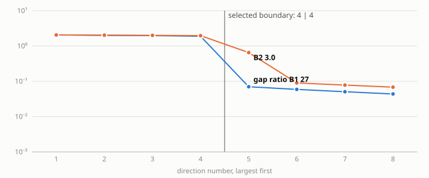
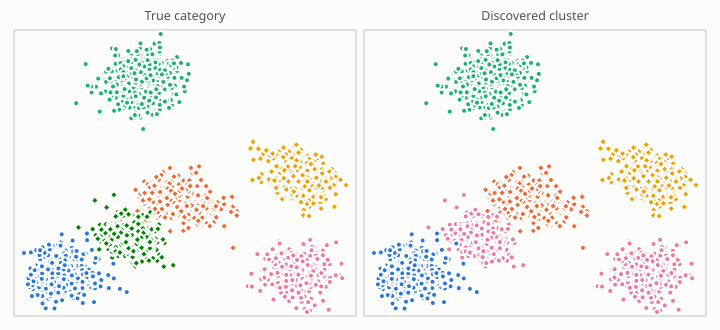
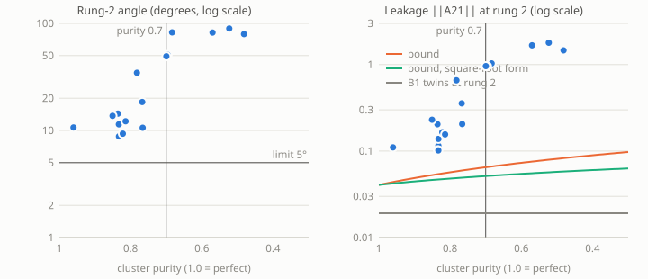
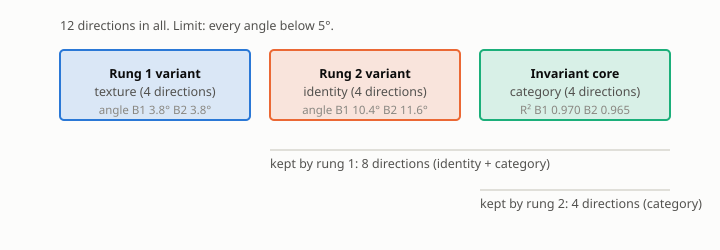

# B2 report (docs/B2.md format)

**Verdict.** B2 MATCHES B1, BUT THE GATES ARE NOT MET IN THIS WORLD (B1 misses them too) (clean world, 3 seeds): construction cost = rung-2 angle +1.28°, identity R² -0.006, category core R² -0.004 against B1; purity 0.83; degradation exceeded the bound in 2 of 3 runs and had no cliff above purity 0.7 (measured against B1); controls C1-C3 failed as required. Gates: B2 misses some (table A); B1 on the same encoders also misses some, so the shortfall comes from the world and encoder, not from building the pairs.

Runs: 3 (spread values [0.1], seeds [0, 1, 2]). Spec: `docs/B2.md`. Clean world: spread 0.1. B1 here means the generator twins on the same encoder and seed. Gates are B1's frozen criteria, including B1's leakage floor that was decided after seeing B1 data.

## A. Gate table (B2, clean world)

| Criterion | Plain meaning | Threshold | B2 measured (mean ± std, 3 seeds) | Pass? |
|---|---|---|---|---|
| Rung 1 angle (texture) | Angle between the recovered texture block and the true one | below 5° | 3.78 ± 0.74 | yes |
| Rung 2 angle (identity) | Same, for the identity block recovered inside what rung 1 kept | below 5° | 11.64 ± 2.77 | **NO** |
| Texture R² (variant R², rung 1) | How well the true texture can be read from its block | above 0.9 | 0.882 ± 0.018 | **NO** |
| Identity R² (variant R², rung 2) | How well the true identity can be read from its block | above 0.9 | 0.916 ± 0.013 | yes |
| Category core R² (invariant R²) | How well the true category can be read from the last 4 directions | above 0.9 | 0.965 ± 0.006 | yes |
| Nesting angle | How far rung 2's block lies outside the true span of what rung 1 kept | below 5° | 10.39 ± 1.53 | **NO** |
| Gap ratio, rung 1 | How sharply 'changes a lot' separates from 'barely changes' | above 10 | 15.7 ± 1.9 | yes |
| Gap ratio, rung 2 | Same at rung 2 | above 10 | 3.1 ± 0.8 | **NO** |
| Leakage, largest |R²| (amended rule) | Worst off-diagonal leakage at rung 1 or 2; B1's floor, decided after seeing B1 data | below 0.01 | 0.0316 ± 0.0044 | **NO** |
| Rank check | Pair differences vary every variant direction (rung 1 and 2) | passes | 1 of 3 seeds pass | **NO** |

For reference, B1 on the same world and encoders:

| Criterion | Plain meaning | Threshold | B1 on the same world and encoders (mean ± std) | Pass? |
|---|---|---|---|---|
| Rung 1 angle (texture) | Angle between the recovered texture block and the true one | below 5° | 3.78 ± 0.74 | yes |
| Rung 2 angle (identity) | Same, for the identity block recovered inside what rung 1 kept | below 5° | 10.35 ± 1.45 | **NO** |
| Texture R² (variant R², rung 1) | How well the true texture can be read from its block | above 0.9 | 0.882 ± 0.018 | **NO** |
| Identity R² (variant R², rung 2) | How well the true identity can be read from its block | above 0.9 | 0.922 ± 0.017 | yes |
| Category core R² (invariant R²) | How well the true category can be read from the last 4 directions | above 0.9 | 0.970 ± 0.004 | yes |
| Nesting angle | How far rung 2's block lies outside the true span of what rung 1 kept | below 5° | 10.28 ± 1.49 | **NO** |
| Gap ratio, rung 1 | How sharply 'changes a lot' separates from 'barely changes' | above 10 | 15.7 ± 1.9 | yes |
| Gap ratio, rung 2 | Same at rung 2 | above 10 | 27.5 ± 4.6 | yes |
| Leakage, largest |R²| (amended rule) | Worst off-diagonal leakage at rung 1 or 2; B1's floor, decided after seeing B1 data | below 0.01 | 0.0239 ± 0.0074 | **NO** |
| Rank check | Pair differences vary every variant direction (rung 1 and 2) | passes | 1 of 3 seeds pass | **NO** |

## B. Paper-standard metrics (rung-2 split; leakage raw, normalized by √block size in brackets)

| Rung 2 split | Global R² | Invariant R² (category core) | Variant R² (identity) | a12 raw (normalized) | a21 raw (normalized) | Block purity |
|---|---|---|---|---|---|---|
| B1 (generator twins) | 0.939 ± 0.003 | 0.970 ± 0.004 | 0.922 ± 0.017 | 0.2980 ± 0.0412 (0.1490 ± 0.0206) | 0.0384 ± 0.0078 (0.0192 ± 0.0039) | 0.98797 ± 0.00267 |
| B2 (discovered clusters) | 0.939 ± 0.003 | 0.965 ± 0.006 | 0.916 ± 0.013 | 0.3397 ± 0.0270 (0.1699 ± 0.0135) | 0.1408 ± 0.0556 (0.0704 ± 0.0278) | 0.98199 ± 0.00409 |
| Paper (single split, 8 numbers) | 0.9977 ± 0.0016 | 0.9980 ± 0.0014 | 0.9974 ± 0.0018 | 0.0034 raw | 0.0233 raw | about 0.99993 |

## C. Construction quality (clean world)

| Seed | Cluster purity | Pair validity | Clusters found (true 6) | Misgroup rate | Pair distance in category space (B2 / perfect labels / random) |
|---|---|---|---|---|---|
| 0 | 0.835 | 0.833 | 5 | 0.165 | 0.57 / 0.27 / n/a |
| 1 | 0.833 | 0.833 | 5 | 0.167 | 0.57 / 0.27 / n/a |
| 2 | 0.834 | 0.836 | 5 | 0.166 | 0.46 / 0.27 / n/a |

## D. Headline: what did construction cost us? (B1 / B2 / Δ per seed, clean world)

| Metric | seed 0: B1 / B2 / Δ | seed 1: B1 / B2 / Δ | seed 2: B1 / B2 / Δ |
|---|---|---|---|
| Rung-2 angle (°) | 10.67 / 14.37 / +3.70 | 8.77 / 8.84 / +0.06 | 11.62 / 11.71 / +0.09 |
| Identity R² | 0.930 / 0.920 / -0.010 | 0.933 / 0.927 / -0.006 | 0.902 / 0.902 / +0.000 |
| Category core R² | 0.971 / 0.962 / -0.009 | 0.974 / 0.972 / -0.002 | 0.966 / 0.963 / -0.003 |
| Nesting angle (°) | 10.64 / 11.00 / +0.35 | 8.64 / 8.65 / +0.01 | 11.55 / 11.52 / -0.03 |
| Gap ratio, rung 2 | 29.3 / 2.7 / -26.6 | 30.8 / 2.6 / -28.2 | 22.2 / 4.1 / -18.2 |
| a12 normalized | 0.1421 / 0.1796 / +0.0375 | 0.1328 / 0.1544 / +0.0217 | 0.1722 / 0.1756 / +0.0034 |
| a21 normalized | 0.0148 / 0.1023 / +0.0875 | 0.0222 / 0.0578 / +0.0357 | 0.0207 / 0.0511 / +0.0304 |
| Block purity | 0.98891 / 0.97741 / -0.01150 | 0.99005 / 0.98529 / -0.00476 | 0.98496 / 0.98328 / -0.00168 |

## Targets

| Target | Observed | Result |
|---|---|---|
| T1 construction cost: B2 angle within 2x of B1, per seed | seed 0: 14.37° vs 10.67° (ratio 1.35); seed 1: 8.84° vs 8.77° (ratio 1.01); seed 2: 11.71° vs 11.62° (ratio 1.01) | met |
| T2 purity ≥ 0.9 and pair validity ≥ 0.95 imply all gates pass | 0 runs qualify; 0 pass every gate | no qualifying run |
| T3 smooth degradation, no cliff above purity 0.7, leakage under the bound | 3 runs above purity 0.7 have angle > 5° (absolute), 0 are also more than twice B1's angle (relative); ||A21|| under the bound in 1 of 3 runs (square-root form: 0) | see figure P8 |
| T4 controls C1-C3 fail as required | C1 yes, C2 yes, C3 yes | met |

### Degradation across the spread sweep (all runs)

| Spread σ_cat | Purity | Misgroup rate | Rung-2 angle B1 (°) | Rung-2 angle B2 (°) | ||A21|| B2 | Bound on ||A21|| | Runs passing all gates |
|---|---|---|---|---|---|---|---|
| 0.1 | 0.83 ± 0.00 | 0.17 ± 0.00 | 10.4 ± 1.4 | 11.6 ± 2.8 | 0.1408 ± 0.0556 | 0.1043 | 0 of 3 |

## Controls

| Control | Required outcome | Observed (clean world) | Result |
|---|---|---|---|
| C1 cross-cluster pairs | angle above 10° and pair validity below 0.95 | angle 88.9°, validity 0.000 | failed as required |
| C2 clusters from the variant block | angle above 10° | angle 76.7°, cluster purity vs true category 0.21 | failed as required |
| C3 singleton clusters | no valid pairs, so the rank check fires | 0 pairs | failed as required |
| C4 shuffled membership (recorded) | no required outcome | angle 87.0°, validity 0.17 | recorded |

## Figures

*P2′. Pair-difference spectrum at rung 2 (log scale): B1 against B2, mean over seeds, clean world.*

*P7. Rung-1 invariant content projected to 2-D (seed 0, clean world). Left: true category. Right: discovered cluster, coloured to match its best-overlapping category. The projection uses the true categories, so it is for the picture only.*

*P8. Degradation: rung-2 angle and ||A21|| against cluster purity, every run of the sweep. Lines: the contamination bound from the monograph, drawn two ways.*

*P5. The ladder: nested blocks with B1 and B2 angles side by side (mean, clean world).*

What success does and does not establish (from the spec): the pipeline is viable without ground truth on synthetic worlds, at a measurable cost relative to B1. It does not establish real-world viability.
