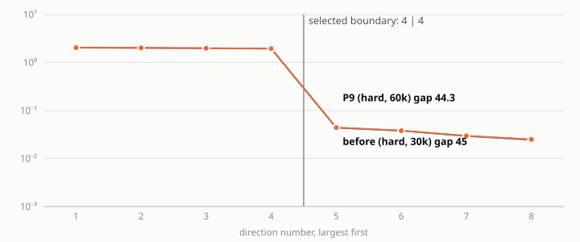
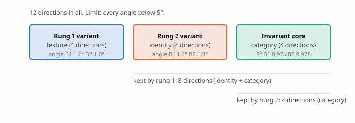

# P9 report: B1 re-run with hard nesting projection and rung-1 budget 60,000 (ground-truth pairs)

**Verdict line.** Nesting (gate definition) moved from 1.28 ± 0.16° to 1.22 ± 0.22° (mean ± std over 3 seeds). Pairs per rung: [60000, 30000]. Enforcement: hard.

## A. Gate table

| Criterion | Threshold | Measured (mean ± std) | Pass? |
|---|---|---|---|
| Rung 1 angle (texture) | below 5° | 0.95 ± 0.25 | yes |
| Rung 2 angle (identity) | below 5° | 1.28 ± 0.18 | yes |
| Texture R² (variant R², rung 1) | above 0.9 | 0.958 ± 0.003 | yes |
| Identity R² (variant R², rung 2) | above 0.9 | 0.983 ± 0.003 | yes |
| Category core R² (invariant R²) | above 0.9 | 0.978 ± 0.002 | yes |
| **Nesting angle** (gate definition: span of true identity+category images) | below 5° | 1.22 ± 0.22 | yes |
| Gap ratio, rung 1 | above 10 | 44.6 ± 5.6 | yes |
| Gap ratio, rung 2 | above 10 | 44.8 ± 5.8 | yes |
| Leakage, largest off-diagonal |R²| (B1 amended rule) | below 0.01 | 0.0007 ± 0.0004 | yes |
| Rank check (statistical test) | passes | 3 of 3 seeds | yes |

## B. Paper-standard metrics (rung-2 split)

| Global R² | Invariant R² | Variant R² | a12_fro | a21_fro | Block purity |
|---|---|---|---|---|---|
| 0.9732 ± 0.0028 | 0.9781 ± 0.0022 | 0.9825 ± 0.0032 | 0.0277 ± 0.0014 | 0.0109 ± 0.0011 | 0.99985 ± 0.00001 |

## Before / after (informational, not a gate)

|  | Earlier B1 (30k per rung) | P9 (60k / 30k) |
|---|---|---|
| Nesting angle, gate definition (°) | 1.28 ± 0.16 | 1.22 ± 0.22 |
| Rung-1 angle (°) | 1.05 ± 0.25 | 0.95 ± 0.25 |
| Rung-2 angle (°) | 1.36 ± 0.10 | 1.28 ± 0.18 |

## Rank-completeness monitor (D9)

| Rung | Seeds passing | λ_min | Noise-floor threshold | Pairs |
|---|---|---|---|---|
| 1 | 3 of 3 | 1.939 ± 0.020 | 0.841 ± 0.009 | 60000 |
| 2 | 3 of 3 | 1.948 ± 0.014 | 0.976 ± 0.041 | 30000 |

## Controls

| Arm | Observed | Note |
|---|---|---|
| shuffled_rung2 | 87.4°, 89.7°, 74.0° (rung-2 angle per seed) | rung-2 gap 1.0 ± 0.0 |
| rank1_rung2 | 84.0°, 81.2°, 75.6° (rung-2 angle per seed) | rung-2 gap 1.3 ± 0.0 |
| no_inv | 25.3°, 31.9°, 27.2° (rung-2 angle per seed) | rung-2 gap 44.8 ± 5.8 |
| no_pred | 1.3°, 0.9°, 1.1° (rung-2 angle per seed) | rung-2 gap 56.0 ± 15.1 |
| no_var | 9.5°, 7.4°, 9.8° (rung-2 angle per seed) | rung-2 gap 15.0 ± 0.5 |

## Attribution (informational, not a gate): where the nesting angle comes from

| Seed | Inherited θ(H₁, H₁*), span truth (°) | Inherited, orthogonal-complement truth (°) | Nesting, span truth (°) | Nesting, orthogonal-complement truth (°) | Recovery θ(V₂, identity image) (°) |
|---|---|---|---|---|---|
| 0 | 2.06 | 0.66 | 1.48 | 0.54 | 1.48 |
| 1 | 1.58 | 1.13 | 1.07 | 0.63 | 1.18 |
| 2 | 1.78 | 1.06 | 1.12 | 0.99 | 1.18 |

## Unit test output
```
hard nesting angle vs true rung-1 subspace: 0.023 deg (budgets 120000/30000)
soft(lambda=1000) vs hard on identical pairs: 0.00141 deg
soft(lambda=10000) vs hard on identical pairs: 0.00812 deg
35 passed, 4 warnings in 26.63s
```


## Figures


