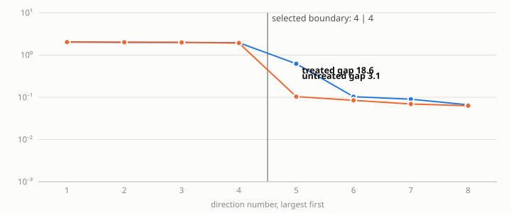
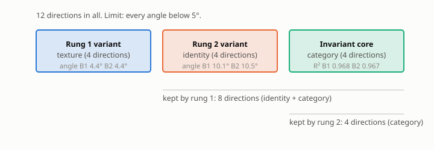

# E11a report: formal B2, clean world (sigma_cat 0.1), 3 seeds, hard nesting, pairs 60,000 / 30,000

**Verdict.** E10 (nesting gate on the D10 reference): B2 arm nesting 3.40 ± 0.80°, inside the 5° gate on every seed; the absolute angle is 10.09 ± 1.89° and is now informational. E12: rung-2 gap ratio B1 23.7, B2 untreated 3.2, Tier 1 17.6, Tier 1 + Tier 4 18.8; recovered fraction of the B1-B2 deficit: Tier 1 0.70, Tier 1 + Tier 4 0.76 (registered treatment; needs ≥ 0.60) -> **CONFIRMED**.

## A. Gate table (registered treatment: B2 + Tier 1 + Tier 4)

| Criterion | Threshold | Measured (mean ± std) | Pass? |
|---|---|---|---|
| Rung 1 angle (texture) | below 5° | 4.45 ± 1.15 | **NO** |
| Rung 2 angle (identity) | below 5° | 10.52 ± 2.00 | **NO** |
| Texture R² (variant R², rung 1) | above 0.9 | 0.865 ± 0.037 | **NO** |
| Identity R² (variant R², rung 2) | above 0.9 | 0.896 ± 0.017 | **NO** |
| Category core R² (invariant R²) | above 0.9 | 0.967 ± 0.004 | yes |
| Nesting angle, D10 definition (orthogonal-complement reference) | below 5° | 3.32 ± 0.74 | yes |
| Gap ratio, rung 1 | above 10 | 9.9 ± 3.1 | **NO** |
| Gap ratio, rung 2 | above 10 | 18.8 ± 2.2 | yes |
| Leakage, normalized ||A21|| at both rungs (gates_v2, D13) | below 0.0209 | 0.0477 ± 0.0125 | **NO** |
| Rank check (statistical test) | passes | 3 of 3 seeds | yes |

Same gates, B2 untreated:

| Criterion | Threshold | Measured (mean ± std) | Pass? |
|---|---|---|---|
| Rung 1 angle (texture) | below 5° | 4.45 ± 1.15 | **NO** |
| Rung 2 angle (identity) | below 5° | 12.20 ± 4.19 | **NO** |
| Texture R² (variant R², rung 1) | above 0.9 | 0.865 ± 0.037 | **NO** |
| Identity R² (variant R², rung 2) | above 0.9 | 0.890 ± 0.022 | **NO** |
| Category core R² (invariant R²) | above 0.9 | 0.962 ± 0.006 | yes |
| Nesting angle, D10 definition (orthogonal-complement reference) | below 5° | 3.40 ± 0.80 | yes |
| Gap ratio, rung 1 | above 10 | 9.9 ± 3.1 | **NO** |
| Gap ratio, rung 2 | above 10 | 3.2 ± 0.7 | **NO** |
| Leakage, normalized ||A21|| at both rungs (gates_v2, D13) | below 0.0209 | 0.0782 ± 0.0376 | **NO** |
| Rank check (statistical test) | passes | 3 of 3 seeds | yes |

Same gates, B1 arm (generator twins) on the same encoders:

| Criterion | Threshold | Measured (mean ± std) | Pass? |
|---|---|---|---|
| Rung 1 angle (texture) | below 5° | 4.45 ± 1.15 | **NO** |
| Rung 2 angle (identity) | below 5° | 10.10 ± 1.76 | **NO** |
| Texture R² (variant R², rung 1) | above 0.9 | 0.865 ± 0.037 | **NO** |
| Identity R² (variant R², rung 2) | above 0.9 | 0.899 ± 0.016 | **NO** |
| Category core R² (invariant R²) | above 0.9 | 0.968 ± 0.004 | yes |
| Nesting angle, D10 definition (orthogonal-complement reference) | below 5° | 3.28 ± 0.63 | yes |
| Gap ratio, rung 1 | above 10 | 9.9 ± 3.1 | **NO** |
| Gap ratio, rung 2 | above 10 | 23.7 ± 2.9 | yes |
| Leakage, normalized ||A21|| at both rungs (gates_v2, D13) | below 0.0209 | 0.0440 ± 0.0081 | **NO** |
| Rank check (statistical test) | passes | 3 of 3 seeds | yes |

## B. Paper-standard metrics (rung-2 split)

| Rung 2 split | Global R² | Invariant R² | Variant R² | a12_fro | a21_fro | Block purity |
|---|---|---|---|---|---|---|
| B1 (generator twins) | 0.9248 ± 0.0117 | 0.9680 ± 0.0040 | 0.8987 ± 0.0163 | 0.2979 ± 0.0465 | 0.0505 ± 0.0075 | 0.98751 ± 0.00285 |
| B2 (discovered clusters) | 0.9248 ± 0.0117 | 0.9620 ± 0.0059 | 0.8895 ± 0.0218 | 0.3619 ± 0.0492 | 0.1564 ± 0.0753 | 0.97852 ± 0.00842 |
| B2 + Tier 1 purification | 0.9248 ± 0.0117 | 0.9680 ± 0.0038 | 0.8974 ± 0.0165 | 0.3046 ± 0.0506 | 0.0659 ± 0.0175 | 0.98671 ± 0.00315 |
| B2 + Tier 1 + Tier 4 (registered treatment) | 0.9248 ± 0.0117 | 0.9670 ± 0.0038 | 0.8960 ± 0.0173 | 0.3174 ± 0.0388 | 0.0815 ± 0.0330 | 0.98536 ± 0.00249 |
| Paper (single split) | 0.9977 | 0.9980 | 0.9974 | 0.0034 | 0.0233 | 0.99993 |

## C. Headline across arms (mean ± std over seeds)

| Metric | B1 (generator twins) | B2 (discovered clusters) | B2 + Tier 1 purification | B2 + Tier 1 + Tier 4 (registered treatment) |
|---|---|---|---|---|
| Rung-2 angle (°) | 10.10 ± 1.76 | 12.20 ± 4.19 | 10.15 ± 1.75 | 10.52 ± 2.00 |
| Identity R² | 0.899 ± 0.016 | 0.890 ± 0.022 | 0.897 ± 0.017 | 0.896 ± 0.017 |
| Category core R² | 0.968 ± 0.004 | 0.962 ± 0.006 | 0.968 ± 0.004 | 0.967 ± 0.004 |
| Gap ratio, rung 2 | 23.7 ± 2.9 | 3.2 ± 0.7 | 17.6 ± 0.6 | 18.8 ± 2.2 |
| Nesting, D10 definition (°) | 3.28 ± 0.63 | 3.40 ± 0.80 | 3.28 ± 0.65 | 3.32 ± 0.74 |
| Nesting, absolute (span truth) (°) - informational diagnostic | 10.00 ± 1.84 | 10.09 ± 1.89 | 9.97 ± 1.87 | 10.06 ± 1.85 |

## Purification (Tier 1) bookkeeping

| Seed | Pair validity before | after | Fraction of pairs kept | Valid pairs kept | Invalid pairs dropped | Iterations | Cluster purity |
|---|---|---|---|---|---|---|---|
| 0 | 0.835 | 1.000 | 0.819 | 0.981 | 1.000 | 5 | 0.836 |
| 1 | 0.830 | 1.000 | 0.817 | 0.984 | 1.000 | 4 | 0.833 |
| 2 | 0.832 | 0.995 | 0.817 | 0.977 | 0.977 | 5 | 0.831 |

## Rank-completeness monitor, rung 2

| Arm | Seeds passing |
|---|---|
| B1 (generator twins) | 3 of 3 |
| B2 (discovered clusters) | 3 of 3 |
| B2 + Tier 1 purification | 3 of 3 |
| B2 + Tier 1 + Tier 4 (registered treatment) | 3 of 3 |

## Controls

| Control | Required outcome | Observed | Result |
|---|---|---|---|
| C1 cross-cluster pairs | angle above 10°, validity below 0.95 | angle 89.6° | yes |
| C2 clusters from variant block | angle above 10° | angle 70.1° | yes |
| C3 singleton clusters | zero valid pairs | 0 pairs | yes |
| C4 shuffled membership (recorded) | none | angle 87.8° | recorded |

## Attribution (informational, not a gate)

| Seed | Inherited, span truth (°) | Inherited, complement truth (°) | Nesting, span truth (°) | Nesting, complement truth (°) | Recovery θ(V₂, identity image) (°) |
|---|---|---|---|---|---|
| 0 | 12.38 | 5.19 | 10.95 | 4.32 | 16.62 |
| 1 | 11.34 | 5.04 | 7.92 | 3.00 | 8.28 |
| 2 | 13.33 | 3.12 | 11.39 | 2.87 | 11.71 |

## Unit-test output (D9)
```
hard nesting angle vs true rung-1 subspace: 0.023 deg (budgets 120000/30000)
soft(lambda=1000) vs hard on identical pairs: 0.00141 deg
soft(lambda=10000) vs hard on identical pairs: 0.00812 deg
38 passed, 4 warnings in 3.84s
```


## Figures



## E11a verdict on the registered floor-lowering prediction: **REFUTED**

| Criterion | Baseline (E12 run / E15) | E11a | Met? |
|---|---|---|---|
| (i) full-feature texture probe R², at least 0.95 on every seed | 0.894 / 0.907 / 0.930 | 0.880 / 0.853 / 0.937 | **NO** |
| (ii) mean rung-1 angle at most 2.8° | 3.78 | 4.45 | **NO** |
| (iii) mean rung-2 angle, B1 arm, at most 7.7° | 10.30 | 10.10 | **NO** |

### Other numbers, baseline vs E11a (per seed, 0 / 1 / 2)

| Quantity | Baseline | E11a |
|---|---|---|
| Recovered texture block R² (rung 1) | 0.862 / 0.887 / 0.897 | 0.856 / 0.833 / 0.905 |
| Global R² | 0.936 / 0.943 / 0.940 | 0.917 / 0.919 / 0.938 |
| Identity / category probe R² | 0.950, 0.971 / 0.950, 0.974 / 0.931, 0.966 | 0.910, 0.970 / 0.934, 0.971 / 0.921, 0.964 |
| Rung-1 angle per seed (°) | 4.59 / 3.62 / 3.12 | 5.19 / 5.04 / 3.12 |
| Rung-2 angle, B1 arm, per seed (°) | 10.68 / 8.63 / 11.58 | 10.69 / 8.12 / 11.50 |
| Rung-2 gap ratio, B2 + Tier 1 | 19.2 / 22.2 / 17.6 | 18.0 / 18.0 / 17.0 |
| Cluster purity, discovered K | 0.834, K=5 / 0.835, K=5 / 0.836, K=5 | 0.836, K=5 / 0.833, K=5 / 0.831, K=5 |