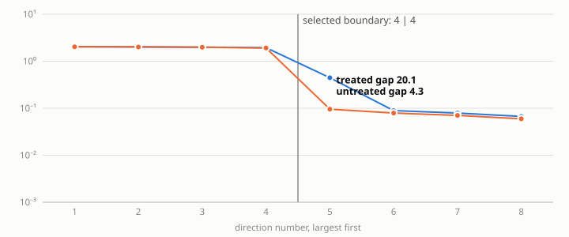
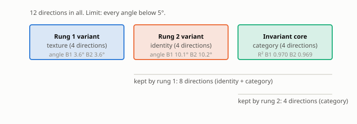

# E11b report: formal B2, clean world (sigma_cat 0.1), 3 seeds, hard nesting, pairs 60,000 / 30,000

**Verdict.** E10 (nesting gate on the D10 reference): B2 arm nesting 2.66 ± 0.56°, inside the 5° gate on every seed; the absolute angle is 9.99 ± 1.41° and is now informational. E12: rung-2 gap ratio B1 27.1, B2 untreated 8.9, Tier 1 20.1, Tier 1 + Tier 4 20.1; recovered fraction of the B1-B2 deficit: Tier 1 0.62, Tier 1 + Tier 4 0.62 (registered treatment; needs ≥ 0.60) -> **CONFIRMED**.

## A. Gate table (registered treatment: B2 + Tier 1 + Tier 4)

| Criterion | Threshold | Measured (mean ± std) | Pass? |
|---|---|---|---|
| Rung 1 angle (texture) | below 5° | 3.63 ± 0.89 | yes |
| Rung 2 angle (identity) | below 5° | 10.19 ± 1.45 | **NO** |
| Texture R² (variant R², rung 1) | above 0.9 | 0.882 ± 0.018 | **NO** |
| Identity R² (variant R², rung 2) | above 0.9 | 0.918 ± 0.020 | **NO** |
| Category core R² (invariant R²) | above 0.9 | 0.969 ± 0.005 | yes |
| Nesting angle, D10 definition (orthogonal-complement reference) | below 5° | 2.67 ± 0.55 | yes |
| Gap ratio, rung 1 | above 10 | 15.6 ± 2.6 | yes |
| Gap ratio, rung 2 | above 10 | 20.1 ± 1.0 | yes |
| Leakage, normalized ||A21|| at both rungs (gates_v2, D13) | below 0.0209 | 0.0418 ± 0.0052 | **NO** |
| Rank check (statistical test) | passes | 3 of 3 seeds | yes |

Same gates, B2 untreated:

| Criterion | Threshold | Measured (mean ± std) | Pass? |
|---|---|---|---|
| Rung 1 angle (texture) | below 5° | 3.63 ± 0.89 | yes |
| Rung 2 angle (identity) | below 5° | 10.16 ± 1.44 | **NO** |
| Texture R² (variant R², rung 1) | above 0.9 | 0.882 ± 0.018 | **NO** |
| Identity R² (variant R², rung 2) | above 0.9 | 0.918 ± 0.018 | **NO** |
| Category core R² (invariant R²) | above 0.9 | 0.968 ± 0.005 | yes |
| Nesting angle, D10 definition (orthogonal-complement reference) | below 5° | 2.66 ± 0.56 | yes |
| Gap ratio, rung 1 | above 10 | 15.6 ± 2.6 | yes |
| Gap ratio, rung 2 | above 10 | 8.9 ± 9.6 | **NO** |
| Leakage, normalized ||A21|| at both rungs (gates_v2, D13) | below 0.0209 | 0.0496 ± 0.0054 | **NO** |
| Rank check (statistical test) | passes | 3 of 3 seeds | yes |

Same gates, B1 arm (generator twins) on the same encoders:

| Criterion | Threshold | Measured (mean ± std) | Pass? |
|---|---|---|---|
| Rung 1 angle (texture) | below 5° | 3.63 ± 0.89 | yes |
| Rung 2 angle (identity) | below 5° | 10.08 ± 1.46 | **NO** |
| Texture R² (variant R², rung 1) | above 0.9 | 0.882 ± 0.018 | **NO** |
| Identity R² (variant R², rung 2) | above 0.9 | 0.920 ± 0.020 | **NO** |
| Category core R² (invariant R²) | above 0.9 | 0.970 ± 0.004 | yes |
| Nesting angle, D10 definition (orthogonal-complement reference) | below 5° | 2.67 ± 0.55 | yes |
| Gap ratio, rung 1 | above 10 | 15.6 ± 2.6 | yes |
| Gap ratio, rung 2 | above 10 | 27.1 ± 4.5 | yes |
| Leakage, normalized ||A21|| at both rungs (gates_v2, D13) | below 0.0209 | 0.0380 ± 0.0082 | **NO** |
| Rank check (statistical test) | passes | 3 of 3 seeds | yes |

## B. Paper-standard metrics (rung-2 split)

| Rung 2 split | Global R² | Invariant R² | Variant R² | a12_fro | a21_fro | Block purity |
|---|---|---|---|---|---|---|
| B1 (generator twins) | 0.9389 ± 0.0036 | 0.9697 ± 0.0043 | 0.9198 ± 0.0200 | 0.3003 ± 0.0410 | 0.0393 ± 0.0109 | 0.98781 ± 0.00270 |
| B2 (discovered clusters) | 0.9389 ± 0.0036 | 0.9684 ± 0.0050 | 0.9175 ± 0.0185 | 0.3186 ± 0.0373 | 0.0789 ± 0.0426 | 0.98563 ± 0.00304 |
| B2 + Tier 1 purification | 0.9389 ± 0.0036 | 0.9697 ± 0.0042 | 0.9181 ± 0.0214 | 0.3102 ± 0.0478 | 0.0466 ± 0.0131 | 0.98691 ± 0.00342 |
| B2 + Tier 1 + Tier 4 (registered treatment) | 0.9389 ± 0.0036 | 0.9690 ± 0.0046 | 0.9184 ± 0.0203 | 0.3104 ± 0.0459 | 0.0707 ± 0.0170 | 0.98653 ± 0.00314 |
| Paper (single split) | 0.9977 | 0.9980 | 0.9974 | 0.0034 | 0.0233 | 0.99993 |

## C. Headline across arms (mean ± std over seeds)

| Metric | B1 (generator twins) | B2 (discovered clusters) | B2 + Tier 1 purification | B2 + Tier 1 + Tier 4 (registered treatment) |
|---|---|---|---|---|
| Rung-2 angle (°) | 10.08 ± 1.46 | 10.16 ± 1.44 | 10.08 ± 1.48 | 10.19 ± 1.45 |
| Identity R² | 0.920 ± 0.020 | 0.918 ± 0.018 | 0.918 ± 0.021 | 0.918 ± 0.020 |
| Category core R² | 0.970 ± 0.004 | 0.968 ± 0.005 | 0.970 ± 0.004 | 0.969 ± 0.005 |
| Gap ratio, rung 2 | 27.1 ± 4.5 | 8.9 ± 9.6 | 20.1 ± 1.9 | 20.1 ± 1.0 |
| Nesting, D10 definition (°) | 2.67 ± 0.55 | 2.66 ± 0.56 | 2.68 ± 0.55 | 2.67 ± 0.55 |
| Nesting, absolute (span truth) (°) - informational diagnostic | 9.99 ± 1.45 | 9.99 ± 1.41 | 10.00 ± 1.46 | 9.94 ± 1.38 |

## Purification (Tier 1) bookkeeping

| Seed | Pair validity before | after | Fraction of pairs kept | Valid pairs kept | Invalid pairs dropped | Iterations | Cluster purity |
|---|---|---|---|---|---|---|---|
| 0 | 0.998 | 1.000 | 0.983 | 0.985 | 1.000 | 4 | 0.999 |
| 1 | 0.832 | 1.000 | 0.817 | 0.982 | 1.000 | 4 | 0.833 |
| 2 | 0.831 | 0.997 | 0.815 | 0.978 | 0.986 | 5 | 0.834 |

## Rank-completeness monitor, rung 2

| Arm | Seeds passing |
|---|---|
| B1 (generator twins) | 3 of 3 |
| B2 (discovered clusters) | 3 of 3 |
| B2 + Tier 1 purification | 3 of 3 |
| B2 + Tier 1 + Tier 4 (registered treatment) | 3 of 3 |

## Controls

| Control | Required outcome | Observed | Result |
|---|---|---|---|
| C1 cross-cluster pairs | angle above 10°, validity below 0.95 | angle 88.5° | yes |
| C2 clusters from variant block | angle above 10° | angle 71.3° | yes |
| C3 singleton clusters | zero valid pairs | 0 pairs | yes |
| C4 shuffled membership (recorded) | none | angle 75.5° | recorded |

## Attribution (informational, not a gate)

| Seed | Inherited, span truth (°) | Inherited, complement truth (°) | Nesting, span truth (°) | Nesting, complement truth (°) | Recovery θ(V₂, identity image) (°) |
|---|---|---|---|---|---|
| 0 | 12.62 | 4.43 | 9.79 | 3.30 | 9.82 |
| 1 | 10.92 | 3.79 | 8.69 | 2.27 | 8.92 |
| 2 | 13.99 | 2.66 | 11.49 | 2.40 | 11.73 |

## Unit-test output (D9)
```
hard nesting angle vs true rung-1 subspace: 0.023 deg (budgets 120000/30000)
soft(lambda=1000) vs hard on identical pairs: 0.00141 deg
soft(lambda=10000) vs hard on identical pairs: 0.00812 deg
38 passed, 4 warnings in 3.84s
```


## Figures



## E11b verdict on the registered floor-lowering prediction: **REFUTED**

| Criterion | Baseline (E12 run / E15) | E11b | Met? |
|---|---|---|---|
| (i) full-feature texture probe R², at least 0.95 on every seed | 0.894 / 0.907 / 0.930 | 0.892 / 0.905 / 0.932 | **NO** |
| (ii) mean rung-1 angle at most 2.8° | 3.78 | 3.63 | **NO** |
| (iii) mean rung-2 angle, B1 arm, at most 7.7° | 10.30 | 10.08 | **NO** |

### Other numbers, baseline vs E11b (per seed, 0 / 1 / 2)

| Quantity | Baseline | E11b |
|---|---|---|
| Recovered texture block R² (rung 1) | 0.862 / 0.887 / 0.897 | 0.862 / 0.885 / 0.898 |
| Global R² | 0.936 / 0.943 / 0.940 | 0.935 / 0.942 / 0.940 |
| Identity / category probe R² | 0.950, 0.971 / 0.950, 0.974 / 0.931, 0.966 | 0.950, 0.971 / 0.950, 0.974 / 0.928, 0.966 |
| Rung-1 angle per seed (°) | 4.59 / 3.62 / 3.12 | 4.43 / 3.79 / 2.66 |
| Rung-2 angle, B1 arm, per seed (°) | 10.68 / 8.63 / 11.58 | 9.82 / 8.77 / 11.65 |
| Rung-2 gap ratio, B2 + Tier 1 | 19.2 / 22.2 / 17.6 | 21.2 / 21.2 / 18.0 |
| Cluster purity, discovered K | 0.834, K=5 / 0.835, K=5 / 0.836, K=5 | 0.999, K=6 / 0.833, K=5 / 0.834, K=5 |