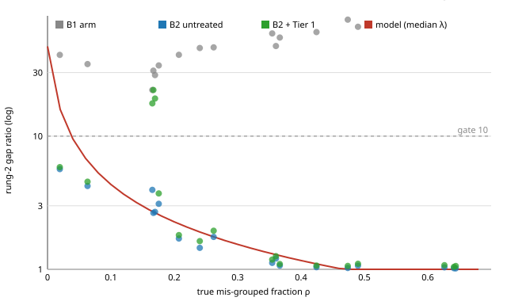

# E13 full report: gap-ratio fix across the noise sweep (formal B2 world, 18 runs)

## 1. What was run

World: formal B2 mixture world (docs/B2.md): blocks texture / identity / category of 4 numbers each, speeds 0.2 / 0.7 / 0.95, 6 categories × 20 identities × 2 textures, scrambled by the paper's 4-layer coupling map, 12 observed numbers. Noise sweep: within-category spread sigma_cat ∈ {0.1, 0.4, 0.6, 0.8, 1.0, 1.5}; seeds 0, 1, 2; 18 runs. Encoder: mirror (inverse-coupling) encoder, paper objective (alignment + SIGReg 1e-6), 10,000 steps, batch 256, lr 3e-3, then frozen; ZCA whitening on 30,000 samples. Rung 1: 60,000 generator twin pairs; rung 2: 30,000 pairs (B1 twins, or pairs inside discovered clusters from the rung-1 invariant output; k-means, K by silhouette); hard nesting; Tier 1 purification (drop pairs scoring over 4 × the median in the bottom eigendirections, up to 5 iterations); Tier 4 arm (within-H₁ whitening) kept for the comparability check. Gates: frozen B1 criteria with the D10 nesting reference and the D13 leakage gate (normalized ‖A21‖ below 0.0209). Protocol and thresholds for the E13 checks were fixed in `docs/EVIDENCE.md` before the run. Wall time about 25 minutes (3 processes, one per seed).

## 2. Verdict

**E13 is REFUTED as registered.** The contamination model does not fit across the sweep (log-gap R² 0.667, needs 0.8) and purified runs sit above the model curve in 10 of 17 runs (needs 90%). Tier 1 recovers the rung-2 gap only in the clean world (sigma_cat 0.1). From 0.4 up it trims 1-3% of pairs and the gap stays at 1-6. The blind E14 check is confirmed for damage (18 of 18 runs) but not for position (14 of 18). Tier 4 shows no case. Details below.

## 3. Headline by noise level (mean ± std over 3 seeds)

| σ_cat | Cluster purity | K found (3 seeds) | True mis-grouped ρ | Rung-2 gap B1 arm | B2 untreated | B2 + Tier 1 | B2 + Tier 1+4 | Pairs trimmed by Tier 1 | ρ̂ (trimmed − B1 clean baseline) |
|---|---|---|---|---|---|---|---|---|---|
| 0.1 | 0.835 ± 0.001 | 5/5/5 | 0.167 ± 0.002 | 27.3 ± 4.6 | 3.1 ± 0.7 | 19.7 ± 2.3 | 18.7 ± 1.4 | 0.181 ± 0.000 | 0.154 ± 0.006 |
| 0.4 | 0.930 ± 0.084 | 6/6/5 | 0.086 ± 0.081 | 36.5 ± 3.7 | 4.3 ± 1.3 | 4.7 ± 1.1 | 4.8 ± 1.1 | 0.021 ± 0.010 | -0.017 ± 0.010 |
| 0.6 | 0.844 ± 0.007 | 6/6/6 | 0.237 ± 0.028 | 44.4 ± 3.1 | 1.6 ± 0.2 | 1.8 ± 0.2 | 1.8 ± 0.2 | 0.017 ± 0.004 | -0.030 ± 0.006 |
| 0.8 | 0.753 ± 0.013 | 11/12/9 | 0.360 ± 0.006 | 53.8 ± 5.9 | 1.1 ± 0.1 | 1.2 ± 0.1 | 1.2 ± 0.1 | 0.011 ± 0.002 | -0.042 ± 0.003 |
| 1.0 | 0.684 ± 0.029 | 10/10/12 | 0.463 ± 0.034 | 67.2 ± 7.3 | 1.0 ± 0.0 | 1.1 ± 0.0 | 1.1 ± 0.0 | 0.009 ± 0.000 | -0.046 ± 0.003 |
| 1.5 | 0.534 ± 0.014 | 9/10/10 | 0.637 ± 0.010 | 127.6 ± 15.1 | 1.0 ± 0.0 | 1.1 ± 0.0 | 1.1 ± 0.0 | 0.009 ± 0.001 | -0.051 ± 0.003 |

## 4. Gate table by noise level: B2 + Tier 1 (canonical treatment) (seeds passing each frozen criterion)

| σ_cat | R1 angle <5° | R2 angle <5° | texture R² >0.9 | identity R² >0.9 | core R² >0.9 | nesting <5° (D10) | R1 gap >10 | R2 gap >10 | leakage ‖A21‖ <0.0209 | rank check |
|---|---|---|---|---|---|---|---|---|---|---|
| 0.1 | 3/3 | 0/3 | 0/3 | 2/3 | 3/3 | 3/3 | 3/3 | 3/3 | 0/3 | 3/3 |
| 0.4 | 3/3 | 0/3 | 3/3 | 3/3 | 3/3 | 3/3 | 3/3 | 0/3 | 0/3 | 3/3 |
| 0.6 | 3/3 | 0/3 | 3/3 | 3/3 | 3/3 | 3/3 | 3/3 | 0/3 | 0/3 | 1/3 |
| 0.8 | 3/3 | 0/3 | 3/3 | 0/3 | 2/3 | 3/3 | 3/3 | 0/3 | 0/3 | 0/3 |
| 1.0 | 3/3 | 0/3 | 3/3 | 0/3 | 0/3 | 3/3 | 3/3 | 0/3 | 0/3 | 0/3 |
| 1.5 | 3/3 | 0/3 | 3/3 | 0/3 | 0/3 | 3/3 | 3/3 | 0/3 | 0/3 | 1/3 |

## 4. Gate table by noise level: B2 untreated (seeds passing each frozen criterion)

| σ_cat | R1 angle <5° | R2 angle <5° | texture R² >0.9 | identity R² >0.9 | core R² >0.9 | nesting <5° (D10) | R1 gap >10 | R2 gap >10 | leakage ‖A21‖ <0.0209 | rank check |
|---|---|---|---|---|---|---|---|---|---|---|
| 0.1 | 3/3 | 0/3 | 0/3 | 3/3 | 3/3 | 3/3 | 3/3 | 0/3 | 0/3 | 3/3 |
| 0.4 | 3/3 | 0/3 | 3/3 | 3/3 | 3/3 | 3/3 | 3/3 | 0/3 | 0/3 | 3/3 |
| 0.6 | 3/3 | 0/3 | 3/3 | 3/3 | 3/3 | 3/3 | 3/3 | 0/3 | 0/3 | 1/3 |
| 0.8 | 3/3 | 0/3 | 3/3 | 0/3 | 2/3 | 3/3 | 3/3 | 0/3 | 0/3 | 0/3 |
| 1.0 | 3/3 | 0/3 | 3/3 | 0/3 | 0/3 | 3/3 | 3/3 | 0/3 | 0/3 | 0/3 |
| 1.5 | 3/3 | 0/3 | 3/3 | 0/3 | 0/3 | 3/3 | 3/3 | 0/3 | 0/3 | 1/3 |

## 4. Gate table by noise level: B1 arm (generator twins, reference) (seeds passing each frozen criterion)

| σ_cat | R1 angle <5° | R2 angle <5° | texture R² >0.9 | identity R² >0.9 | core R² >0.9 | nesting <5° (D10) | R1 gap >10 | R2 gap >10 | leakage ‖A21‖ <0.0209 | rank check |
|---|---|---|---|---|---|---|---|---|---|---|
| 0.1 | 3/3 | 0/3 | 0/3 | 3/3 | 3/3 | 3/3 | 3/3 | 3/3 | 0/3 | 3/3 |
| 0.4 | 3/3 | 0/3 | 3/3 | 3/3 | 3/3 | 3/3 | 3/3 | 3/3 | 1/3 | 3/3 |
| 0.6 | 3/3 | 0/3 | 3/3 | 3/3 | 3/3 | 3/3 | 3/3 | 3/3 | 3/3 | 3/3 |
| 0.8 | 3/3 | 0/3 | 3/3 | 3/3 | 3/3 | 3/3 | 3/3 | 3/3 | 3/3 | 3/3 |
| 1.0 | 3/3 | 0/3 | 3/3 | 3/3 | 3/3 | 3/3 | 3/3 | 3/3 | 3/3 | 3/3 |
| 1.5 | 3/3 | 0/3 | 3/3 | 3/3 | 3/3 | 3/3 | 3/3 | 3/3 | 3/3 | 3/3 |

## 5. Measured values, B2 + Tier 1 (mean ± std over seeds)

| Metric | σ 0.1 | σ 0.4 | σ 0.6 | σ 0.8 | σ 1.0 | σ 1.5 |
|---|---|---|---|---|---|---|
| R1 angle (°) | 3.78 ± 0.74 | 1.89 ± 0.25 | 1.60 ± 0.25 | 1.47 ± 0.31 | 1.28 ± 0.32 | 1.13 ± 0.27 |
| R2 angle (°) | 10.30 ± 1.53 | 10.14 ± 1.43 | 11.71 ± 1.88 | 40.35 ± 24.40 | 65.09 ± 17.27 | 84.10 ± 3.89 |
| texture R² | 0.882 ± 0.018 | 0.923 ± 0.003 | 0.932 ± 0.005 | 0.936 ± 0.003 | 0.939 ± 0.004 | 0.943 ± 0.006 |
| identity R² | 0.920 ± 0.018 | 0.935 ± 0.013 | 0.930 ± 0.016 | 0.804 ± 0.101 | 0.657 ± 0.083 | 0.244 ± 0.065 |
| core R² | 0.970 ± 0.004 | 0.975 ± 0.003 | 0.971 ± 0.003 | 0.859 ± 0.096 | 0.709 ± 0.081 | 0.288 ± 0.066 |
| nesting D10 (°) | 2.81 ± 0.49 | 1.59 ± 0.13 | 1.30 ± 0.13 | 1.22 ± 0.10 | 0.96 ± 0.13 | 0.63 ± 0.04 |
| R1 gap | 15.83 ± 2.06 | 25.24 ± 1.52 | 29.41 ± 3.19 | 32.35 ± 5.75 | 35.77 ± 7.01 | 38.28 ± 5.59 |
| R2 gap | 19.66 ± 2.33 | 4.70 ± 1.07 | 1.80 ± 0.16 | 1.18 ± 0.08 | 1.08 ± 0.02 | 1.06 ± 0.02 |
| ‖A21‖ norm (max of rungs) | 0.039 ± 0.007 | 0.037 ± 0.010 | 0.094 ± 0.020 | 0.322 ± 0.102 | 0.517 ± 0.076 | 0.838 ± 0.064 |

## 6. Paper-standard metrics, rung-2 split, B2 + Tier 1

| σ_cat | Global R² | Invariant R² | Variant R² | a12_fro | a21_fro | Block purity |
|---|---|---|---|---|---|---|
| 0.1 | 0.9395 ± 0.0034 | 0.9699 ± 0.0039 | 0.9205 ± 0.0178 | 0.3054 ± 0.0419 | 0.0505 ± 0.0073 | 0.98727 ± 0.00284 |
| 0.4 | 0.9604 ± 0.0025 | 0.9747 ± 0.0028 | 0.9349 ± 0.0132 | 0.3053 ± 0.0500 | 0.0745 ± 0.0202 | 0.98637 ± 0.00394 |
| 0.6 | 0.9660 ± 0.0021 | 0.9712 ± 0.0029 | 0.9301 ± 0.0163 | 0.3348 ± 0.0635 | 0.1880 ± 0.0409 | 0.97816 ± 0.00722 |
| 0.8 | 0.9686 ± 0.0002 | 0.8595 ± 0.0962 | 0.8045 ± 0.1009 | 0.6091 ± 0.1603 | 0.6447 ± 0.2032 | 0.86837 ± 0.08285 |
| 1.0 | 0.9709 ± 0.0008 | 0.7093 ± 0.0815 | 0.6568 ± 0.0828 | 0.7941 ± 0.1065 | 1.0349 ± 0.1512 | 0.71120 ± 0.07566 |
| 1.5 | 0.9753 ± 0.0012 | 0.2882 ± 0.0660 | 0.2436 ± 0.0646 | 0.9535 ± 0.0489 | 1.6751 ± 0.1286 | 0.28474 ± 0.06752 |
| Paper (single split) | 0.9977 | 0.9980 | 0.9974 | 0.0034 | 0.0233 | 0.99993 |

## 7. Controls (required: C1 angle > 10° and validity < 0.95; C2 angle > 10°; C3 zero pairs; C4 recorded) and rank monitor

| σ_cat | C1 cross-cluster: angle / validity | C2 variant-block clusters: angle | C3 singleton: pairs | C4 shuffled: angle | Rank monitor passes (B2 untreated, B2 + Tier 1) |
|---|---|---|---|---|---|
| 0.1 | 89.0° / 0.000 | 74.1° | 0 | 84.4° | 3/3, 3/3 |
| 0.4 | 89.5° / 0.006 | 76.8° | 0 | 72.7° | 3/3, 3/3 |
| 0.6 | 86.8° / 0.044 | 77.7° | 0 | 69.6° | 3/3, 3/3 |
| 0.8 | 81.4° / 0.113 | 81.2° | 0 | 83.4° | 3/3, 3/3 |
| 1.0 | 76.8° / 0.125 | 74.8° | 0 | 80.7° | 3/3, 3/3 |
| 1.5 | 73.8° / 0.143 | 85.0° | 0 | 80.0° | 3/3, 3/3 |

C1 failed as required at every noise level; C2 failed as required; C3 zero pairs everywhere.

## 8. Attribution (informational, not a gate): where the angles come from, every run

| σ_cat | seed | Rung-1 angle (°) | Inherited θ(H₁,H₁*) span truth (°) | Inherited, complement truth (°) | Nesting, span truth (°) | Nesting, complement truth (°) | Rung-2 angle B1 arm (°) | Rung-2 angle B2 + Tier 1 (°) |
|---|---|---|---|---|---|---|---|---|
| 0.1 | 0 | 4.59 | 12.86 | 4.59 | 10.99 | 3.37 | 10.68 | 10.71 |
| 0.1 | 1 | 3.62 | 10.69 | 3.62 | 8.48 | 2.28 | 8.63 | 8.61 |
| 0.1 | 2 | 3.12 | 13.61 | 3.12 | 11.48 | 2.79 | 11.58 | 11.60 |
| 0.4 | 0 | 1.89 | 13.41 | 1.89 | 10.20 | 1.65 | 10.48 | 10.59 |
| 0.4 | 1 | 2.14 | 10.46 | 2.14 | 8.33 | 1.68 | 8.42 | 8.54 |
| 0.4 | 2 | 1.65 | 13.04 | 1.65 | 11.04 | 1.44 | 11.02 | 11.29 |
| 0.6 | 0 | 1.58 | 12.78 | 1.58 | 10.25 | 1.30 | 10.24 | 12.58 |
| 0.6 | 1 | 1.86 | 9.86 | 1.86 | 8.73 | 1.43 | 8.43 | 9.55 |
| 0.6 | 2 | 1.36 | 12.41 | 1.36 | 10.80 | 1.17 | 10.73 | 13.00 |
| 0.8 | 0 | 1.32 | 12.28 | 1.32 | 10.42 | 1.15 | 10.20 | 24.87 |
| 0.8 | 1 | 1.83 | 9.43 | 1.83 | 7.37 | 1.35 | 8.38 | 68.47 |
| 0.8 | 2 | 1.26 | 11.87 | 1.26 | 10.46 | 1.17 | 10.64 | 27.70 |
| 1.0 | 0 | 1.10 | 11.82 | 1.10 | 10.51 | 0.83 | 10.14 | 48.97 |
| 1.0 | 1 | 1.65 | 9.18 | 1.65 | 6.14 | 0.96 | 8.32 | 83.32 |
| 1.0 | 2 | 1.10 | 11.65 | 1.10 | 11.22 | 1.08 | 10.69 | 62.98 |
| 1.5 | 0 | 0.89 | 10.80 | 0.89 | 8.23 | 0.62 | 10.04 | 80.17 |
| 1.5 | 1 | 1.42 | 8.96 | 1.42 | 6.67 | 0.59 | 8.41 | 87.94 |
| 1.5 | 2 | 1.07 | 11.15 | 1.07 | 6.17 | 0.69 | 10.49 | 84.20 |

## 9. The registered E13 checks, per-run table and figure

**Model fit:** v_cat = 3.981; log-gap R² = 0.667 (needs ≥ 0.8); median absolute relative error = 0.19 (needs ≤ 0.25) -> **DOES NOT FIT**.

**Purified above the curve:** Tier 1 gap exceeds the predicted untreated gap in 10 of 17 runs with ρ > 0.05 (needs ≥ 90%) -> **NO**.

**Blind E14:** no metric damaged in 18 of 18 runs; treated subspace no farther from the B1-arm subspace in 14 of 18 runs -> **NOT CONFIRMED in every run**.

**Tier 4 comparability:** coefficient of variation of the rung-2 gap across runs, Tier 1 1.419, Tier 1 + Tier 4 1.384 (Tier 4 keeps a case only if ≤ 75% of Tier 1's) -> **no case**.

**ρ-hat vs true ρ:** correlation -0.498; mean ρ-hat -0.005 vs mean ρ 0.325.

| σ_cat | seed | Cluster purity | K found | True ρ | Gap B1 | Gap B2 untreated | Gap predicted (model) | Gap Tier 1 | Gap Tier 1+4 | ρ-hat | No damage (E14) | Closer to B1 subspace (E14) |
|---|---|---|---|---|---|---|---|---|---|---|---|---|
| 0.1 | 0 | 0.834 | 5 | 0.170 | 28.7 | 2.7 | 2.5 | 19.2 | 17.0 | 0.159 | yes | yes |
| 0.1 | 1 | 0.835 | 5 | 0.167 | 31.0 | 2.7 | 2.7 | 22.2 | 19.5 | 0.157 | yes | yes |
| 0.1 | 2 | 0.836 | 5 | 0.165 | 22.2 | 3.9 | 2.6 | 17.6 | 19.5 | 0.147 | yes | yes |
| 0.4 | 0 | 0.967 | 6 | 0.063 | 34.7 | 4.2 | 6.1 | 4.5 | 4.6 | -0.015 | yes | yes |
| 0.4 | 1 | 0.990 | 6 | 0.019 | 40.7 | 5.7 | 15.5 | 5.8 | 5.9 | -0.027 | yes | yes |
| 0.4 | 2 | 0.834 | 5 | 0.176 | 33.9 | 3.1 | 2.5 | 3.7 | 3.7 | -0.008 | yes | yes |
| 0.6 | 0 | 0.849 | 6 | 0.240 | 45.9 | 1.4 | 1.9 | 1.6 | 1.6 | -0.033 | yes | yes |
| 0.6 | 1 | 0.835 | 6 | 0.262 | 46.4 | 1.8 | 1.8 | 1.9 | 1.9 | -0.023 | yes | yes |
| 0.6 | 2 | 0.848 | 6 | 0.207 | 40.8 | 1.7 | 2.2 | 1.8 | 1.8 | -0.034 | yes | yes |
| 0.8 | 0 | 0.769 | 11 | 0.354 | 59.1 | 1.1 | 1.3 | 1.2 | 1.2 | -0.042 | yes | yes |
| 0.8 | 1 | 0.744 | 12 | 0.366 | 55.0 | 1.1 | 1.3 | 1.1 | 1.1 | -0.039 | yes | yes |
| 0.8 | 2 | 0.747 | 9 | 0.360 | 47.5 | 1.2 | 1.3 | 1.3 | 1.3 | -0.045 | yes | yes |
| 1.0 | 0 | 0.688 | 10 | 0.474 | 74.9 | 1.0 | 1.0 | 1.1 | 1.0 | -0.045 | yes | yes |
| 1.0 | 1 | 0.653 | 10 | 0.490 | 66.2 | 1.1 | 1.0 | 1.1 | 1.1 | -0.044 | yes | yes |
| 1.0 | 2 | 0.711 | 12 | 0.424 | 60.4 | 1.0 | 1.1 | 1.1 | 1.1 | -0.050 | yes | **NO** |
| 1.5 | 0 | 0.541 | 9 | 0.641 | 139.7 | 1.0 | 0.7 | 1.0 | 1.0 | -0.050 | yes | **NO** |
| 1.5 | 1 | 0.518 | 10 | 0.644 | 132.5 | 1.0 | 0.7 | 1.1 | 1.0 | -0.049 | yes | **NO** |
| 1.5 | 2 | 0.543 | 10 | 0.626 | 110.7 | 1.0 | 0.7 | 1.1 | 1.1 | -0.055 | yes | **NO** |

## Exploratory (post hoc, NOT the registered test): a within-category floor

Pairs built from clusters share the category label but not the category jitter, so even perfectly valid cluster pairs carry energy of about 2 sigma_cat^2 in the category directions; the B1 twins share the jitter exactly, so the B1 eigenvalue understates the floor for cluster pairs. Runs with almost no invalid pairs (rho < 0.03), fifth eigenvalue of the B1 arm vs the untreated B2 arm vs 2 sigma_cat^2: sigma 0.4: 0.047 vs 0.342 vs 0.320 (rho 0.019).

Refit with a free within-category coefficient c: gap = lambda_d2 / (lambda_d2+1^B1 + c sigma_cat^2 + rho v_cat), best c = 0.4, v_cat = 3.16: log-gap R² = 0.714, median relative error 0.22. Two free parameters instead of one and fitted after seeing the data, so it is a lead, not a confirmation.

## 10. Observations beyond the registered checks (informational, not tests)

| σ_cat | Full-feature texture probe R² (E15 measure) | Recovered texture block R² | Rung-1 angle (°) | Rung-2 angle, B1 arm (°) | Inherited error, complement truth (°) | Inherited error, span truth (°) |
|---|---|---|---|---|---|---|
| 0.1 | 0.910 | 0.882 | 3.78 | 10.30 | 3.78 | 12.39 |
| 0.4 | 0.947 | 0.923 | 1.89 | 9.97 | 1.89 | 12.30 |
| 0.6 | 0.954 | 0.932 | 1.60 | 9.80 | 1.60 | 11.68 |
| 0.8 | 0.956 | 0.936 | 1.47 | 9.74 | 1.47 | 11.19 |
| 1.0 | 0.957 | 0.939 | 1.28 | 9.72 | 1.28 | 10.89 |
| 1.5 | 0.958 | 0.943 | 1.13 | 9.64 | 1.13 | 10.31 |

* **The texture and rung-1 'floor' is specific to the smallest noise level.** At σ_cat 0.1 the texture probe is 0.910, the texture block 0.882 and the rung-1 angle 3.78°. From σ_cat 0.4 up the rung-1 angle is 1.9° and falls to 1.1°, the texture block is 0.92-0.94 (passing), and the probe is 0.947-0.958 (at or above the E15 line of 0.95 from σ 0.6). So the encoder-side shortfall that E15 and E11 chased belongs to the world with the tightest category clusters, not to the encoder in general. Why is not tested here.
* **The rung-2 angle of about 10° does not move with the noise level.** For the B1 arm (true twins) it is 9.6-10.3° at every σ_cat while the rung-1 error against the complement truth falls from 3.8° to about 1.1° (means). The inherited error against the span truth stays at 9-13°. The rung-2 angle is measured against the identity block's probe image, so this constant 10° looks like the same non-orthogonal-probe-image definition effect found for nesting (D10), not an encoder floor. This is an observation from this sweep, not a tested explanation.
* **At σ_cat ≥ 0.8 the splitter is not what fails.** The B1 arm keeps rung-2 gaps of 48-140 and every gate passes for it except the rung-2 angle (about 10°, and leakage at σ_cat 0.1 and 0.4), while the cluster-built arms collapse (rung-2 angle 40-84°, identity R² 0.24-0.80) because the clusters are impure (9-12 found at purity 0.53-0.77). The ceiling analysis (`CLUSTER_LIMITS.md`) shows the limit is mostly the overlap of the categories themselves: even the best possible rule that sees the true category block reaches purity only 0.87 / 0.77 / 0.58 at σ_cat 0.8 / 1.0 / 1.5, and the clusterer is within 0.12 / 0.09 / 0.05 of it.

## 11. Caveats

* 18 runs, 3 seeds per noise level; standard deviations over 3 seeds are rough.
* The E13 thresholds (R² ≥ 0.8, median error ≤ 25%, 90% above the curve, CV ratio 0.75) were mine, fixed before the run and flagged; the formula was the owner's.
* The model's 'clean' floor was taken from the B1 arm (generator twins), which share their category jitter exactly; cluster-built pairs do not, so the floor is understated for them. The explanation in section 9 (within-category energy about 2 σ_cat²) is an observation from the run files, supported directly by one run (σ 0.4 seed 1, almost no invalid pairs). The refit that adds it is post hoc.
* At σ ≥ 0.8 the cluster-built arms fail because cluster purity is capped by the overlap of the categories (see section 10), not because of the splitter; the B1 arm (true twins) keeps gaps of 48-140.
* This sweep does not test the encoder floor, texture R² (0.88) or the rung-2 angle (about 10°), which stay open.

Files: `results/stage_b2_gapfix_sweep/sigma_cat_*/<seed>.json` (raw), `E13_REPORT.md` (analysis), `REPORT.md` (this file), `figures/E13_gap_vs_contamination.svg`. Protocol and outcome: `docs/EVIDENCE.md`.