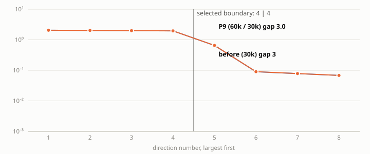
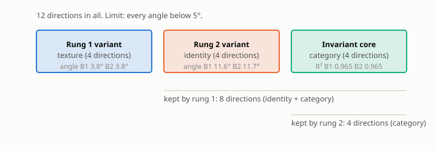

# P9 report: formal B2 re-run with hard nesting projection and rung-1 budget 60,000 (clean world, sigma_cat 0.1)

**Verdict line.** Nesting (gate definition), B2 arm: 10.39 ± 1.53° earlier → 10.31 ± 1.61° now (mean ± std, 3 seeds); with the orthogonal-complement truth: 2.82 ± 0.55°. Pairs per rung: [60000, 30000].

## A. Gate table (B2 arm)

| Criterion | Threshold | Measured (mean ± std) | Pass? |
|---|---|---|---|
| Rung 1 angle (texture) | below 5° | 3.78 ± 0.74 | yes |
| Rung 2 angle (identity) | below 5° | 11.68 ± 3.04 | **NO** |
| Texture R² (variant R², rung 1) | above 0.9 | 0.882 ± 0.018 | **NO** |
| Identity R² (variant R², rung 2) | above 0.9 | 0.915 ± 0.012 | yes |
| Category core R² (invariant R²) | above 0.9 | 0.965 ± 0.006 | yes |
| **Nesting angle** (gate definition: span of true identity+category images) | below 5° | 10.31 ± 1.61 | **NO** |
| Gap ratio, rung 1 | above 10 | 15.8 ± 2.1 | yes |
| Gap ratio, rung 2 | above 10 | 3.1 ± 0.7 | **NO** |
| Leakage, largest off-diagonal |R²| (B1 amended rule) | below 0.01 | 0.0324 ± 0.0044 | **NO** |
| Rank check (statistical test) | passes | 3 of 3 seeds | yes |

For reference, the B1 arm (generator twins) on the same encoders:

| Criterion | Threshold | Measured (mean ± std) | Pass? |
|---|---|---|---|
| Rung 1 angle (texture) | below 5° | 3.78 ± 0.74 | yes |
| Rung 2 angle (identity) | below 5° | 10.30 ± 1.51 | **NO** |
| Texture R² (variant R², rung 1) | above 0.9 | 0.882 ± 0.018 | **NO** |
| Identity R² (variant R², rung 2) | above 0.9 | 0.922 ± 0.017 | yes |
| Category core R² (invariant R²) | above 0.9 | 0.970 ± 0.004 | yes |
| **Nesting angle** (gate definition: span of true identity+category images) | below 5° | 10.21 ± 1.57 | **NO** |
| Gap ratio, rung 1 | above 10 | 15.8 ± 2.1 | yes |
| Gap ratio, rung 2 | above 10 | 27.3 ± 4.6 | yes |
| Leakage, largest off-diagonal |R²| (B1 amended rule) | below 0.01 | 0.0240 ± 0.0075 | **NO** |
| Rank check (statistical test) | passes | 3 of 3 seeds | yes |

## B. Paper-standard metrics (rung-2 split)

| Rung 2 split | Global R² | Invariant R² | Variant R² | a12_fro | a21_fro | Block purity |
|---|---|---|---|---|---|---|
| B1 (generator twins) | 0.9395 ± 0.0034 | 0.9699 ± 0.0040 | 0.9217 ± 0.0173 | 0.2982 ± 0.0413 | 0.0404 ± 0.0078 | 0.98794 ± 0.00268 |
| B2 (discovered clusters) | 0.9395 ± 0.0034 | 0.9651 ± 0.0058 | 0.9154 ± 0.0124 | 0.3441 ± 0.0256 | 0.1457 ± 0.0607 | 0.98139 ± 0.00438 |
| Paper (single split) | 0.9977 | 0.9980 | 0.9974 | 0.0034 | 0.0233 | 0.99993 |

## D. Headline: B1 / B2 / Δ per seed

| Metric | seed 0 | seed 1 | seed 2 |
|---|---|---|---|
| Rung-2 angle (°) | 10.68 / 14.74 / +4.06 | 8.63 / 8.66 / +0.03 | 11.58 / 11.65 / +0.07 |
| Identity R² | 0.930 / 0.919 / -0.011 | 0.933 / 0.926 / -0.007 | 0.902 / 0.902 / -0.000 |
| Category core R² | 0.971 / 0.961 / -0.010 | 0.974 / 0.972 / -0.002 | 0.966 / 0.963 / -0.003 |
| Nesting, gate definition (°) | 10.64 / 10.99 / +0.34 | 8.48 / 8.48 / -0.00 | 11.52 / 11.48 / -0.04 |
| Nesting, orthogonal-complement truth (°) | 3.25 / 3.37 / +0.13 | 2.29 / 2.28 / -0.00 | 2.87 / 2.79 / -0.07 |
| Gap ratio, rung 2 | 28.7 / 2.7 / -26.0 | 31.0 / 2.7 / -28.4 | 22.2 / 3.9 / -18.3 |

## Before / after (informational)

|  | Earlier (30k) | P9 (60k / 30k) |
|---|---|---|
| Nesting, B2 arm, gate definition (°) | 10.39 ± 1.53 | 10.31 ± 1.61 |
| Nesting gap B2 − B1 (°) | 0.11 ± 0.21 | 0.10 ± 0.21 |
| Rung-1 angle (°) | 3.78 ± 0.74 | 3.78 ± 0.74 |

## Rank-completeness monitor (D9)

| Rung | Seeds passing | λ_min | Threshold | Pairs |
|---|---|---|---|---|
| 1 | 3 of 3 | 0.892 ± 0.053 | 0.703 ± 0.096 | 60000 |
| 2 (B2 clusters) | 3 of 3 | 1.953 ± 0.012 | 0.883 ± 0.181 | 29999 |

## Controls

| Control | Required outcome | Observed | Result |
|---|---|---|---|
| C1 cross-cluster pairs | angle above 10°, validity below 0.95 | angle 89.0°, validity 0.000 | yes |
| C2 clusters from variant block | angle above 10° | angle 74.1° | yes |
| C3 singleton clusters | zero valid pairs | 0 pairs | yes |
| C4 shuffled membership (recorded) | none | angle 84.4° | recorded |

## Attribution (informational, not a gate)

| Seed | Inherited, span truth (°) | Inherited, orthogonal-complement truth (°) | Nesting, span truth (°) | Nesting, orthogonal-complement truth (°) | Recovery θ(V₂, identity image) (°) |
|---|---|---|---|---|---|
| 0 | 12.86 | 4.59 | 10.99 | 3.37 | 14.74 |
| 1 | 10.69 | 3.62 | 8.48 | 2.28 | 8.66 |
| 2 | 13.61 | 3.12 | 11.48 | 2.79 | 11.65 |

## Unit test output
```
hard nesting angle vs true rung-1 subspace: 0.023 deg (budgets 120000/30000)
soft(lambda=1000) vs hard on identical pairs: 0.00141 deg
soft(lambda=10000) vs hard on identical pairs: 0.00812 deg
35 passed, 4 warnings in 26.63s
```


## Figures


