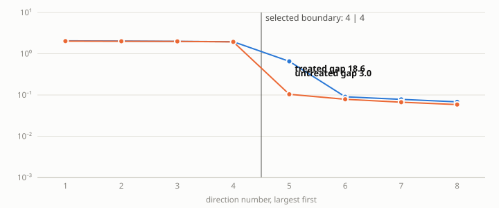
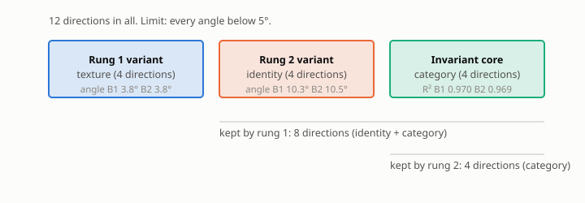

# E10 / E10a report: formal B2, clean world (sigma_cat 0.1), 3 seeds, hard nesting, pairs 60,000 / 30,000

**Verdict.** E10 (nesting gate on the D10 reference): B2 arm nesting 2.82 ± 0.55°, inside the 5° gate on every seed; the absolute angle is 10.31 ± 1.61° and is now informational. E10a: rung-2 gap ratio B1 27.3, B2 untreated 3.1, Tier 1 19.7, Tier 1 + Tier 4 18.7; recovered fraction of the B1-B2 deficit: Tier 1 0.68, Tier 1 + Tier 4 0.64 (registered treatment; needs ≥ 0.60) -> **CONFIRMED**.

## A. Gate table (registered treatment: B2 + Tier 1 + Tier 4)

| Criterion | Threshold | Measured (mean ± std) | Pass? |
|---|---|---|---|
| Rung 1 angle (texture) | below 5° | 3.78 ± 0.74 | yes |
| Rung 2 angle (identity) | below 5° | 10.55 ± 1.65 | **NO** |
| Texture R² (variant R², rung 1) | above 0.9 | 0.882 ± 0.018 | **NO** |
| Identity R² (variant R², rung 2) | above 0.9 | 0.919 ± 0.016 | yes |
| Category core R² (invariant R²) | above 0.9 | 0.969 ± 0.004 | yes |
| Nesting angle, D10 definition (orthogonal-complement reference) | below 5° | 2.79 ± 0.50 | yes |
| Gap ratio, rung 1 | above 10 | 15.8 ± 2.1 | yes |
| Gap ratio, rung 2 | above 10 | 18.7 ± 1.4 | yes |
| Leakage, largest off-diagonal |R²| (B1 amended rule) | below 0.01 | 0.0277 ± 0.0060 | **NO** |
| Rank check (statistical test) | passes | 3 of 3 seeds | yes |

Same gates, B2 untreated:

| Criterion | Threshold | Measured (mean ± std) | Pass? |
|---|---|---|---|
| Rung 1 angle (texture) | below 5° | 3.78 ± 0.74 | yes |
| Rung 2 angle (identity) | below 5° | 11.68 ± 3.04 | **NO** |
| Texture R² (variant R², rung 1) | above 0.9 | 0.882 ± 0.018 | **NO** |
| Identity R² (variant R², rung 2) | above 0.9 | 0.915 ± 0.012 | yes |
| Category core R² (invariant R²) | above 0.9 | 0.965 ± 0.006 | yes |
| Nesting angle, D10 definition (orthogonal-complement reference) | below 5° | 2.82 ± 0.55 | yes |
| Gap ratio, rung 1 | above 10 | 15.8 ± 2.1 | yes |
| Gap ratio, rung 2 | above 10 | 3.1 ± 0.7 | **NO** |
| Leakage, largest off-diagonal |R²| (B1 amended rule) | below 0.01 | 0.0324 ± 0.0044 | **NO** |
| Rank check (statistical test) | passes | 3 of 3 seeds | yes |

Same gates, B1 arm (generator twins) on the same encoders:

| Criterion | Threshold | Measured (mean ± std) | Pass? |
|---|---|---|---|
| Rung 1 angle (texture) | below 5° | 3.78 ± 0.74 | yes |
| Rung 2 angle (identity) | below 5° | 10.30 ± 1.51 | **NO** |
| Texture R² (variant R², rung 1) | above 0.9 | 0.882 ± 0.018 | **NO** |
| Identity R² (variant R², rung 2) | above 0.9 | 0.922 ± 0.017 | yes |
| Category core R² (invariant R²) | above 0.9 | 0.970 ± 0.004 | yes |
| Nesting angle, D10 definition (orthogonal-complement reference) | below 5° | 2.80 ± 0.48 | yes |
| Gap ratio, rung 1 | above 10 | 15.8 ± 2.1 | yes |
| Gap ratio, rung 2 | above 10 | 27.3 ± 4.6 | yes |
| Leakage, largest off-diagonal |R²| (B1 amended rule) | below 0.01 | 0.0240 ± 0.0075 | **NO** |
| Rank check (statistical test) | passes | 3 of 3 seeds | yes |

## B. Paper-standard metrics (rung-2 split)

| Rung 2 split | Global R² | Invariant R² | Variant R² | a12_fro | a21_fro | Block purity |
|---|---|---|---|---|---|---|
| B1 (generator twins) | 0.9395 ± 0.0034 | 0.9699 ± 0.0040 | 0.9217 ± 0.0173 | 0.2982 ± 0.0413 | 0.0404 ± 0.0078 | 0.98794 ± 0.00268 |
| B2 (discovered clusters) | 0.9395 ± 0.0034 | 0.9651 ± 0.0058 | 0.9154 ± 0.0124 | 0.3441 ± 0.0256 | 0.1457 ± 0.0607 | 0.98139 ± 0.00438 |
| B2 + Tier 1 purification | 0.9395 ± 0.0034 | 0.9699 ± 0.0039 | 0.9205 ± 0.0178 | 0.3054 ± 0.0419 | 0.0505 ± 0.0073 | 0.98727 ± 0.00284 |
| B2 + Tier 1 + Tier 4 (registered treatment) | 0.9395 ± 0.0034 | 0.9690 ± 0.0040 | 0.9191 ± 0.0159 | 0.3181 ± 0.0318 | 0.0775 ± 0.0222 | 0.98581 ± 0.00189 |
| Paper (single split) | 0.9977 | 0.9980 | 0.9974 | 0.0034 | 0.0233 | 0.99993 |

## C. Headline across arms (mean ± std over seeds)

| Metric | B1 (generator twins) | B2 (discovered clusters) | B2 + Tier 1 purification | B2 + Tier 1 + Tier 4 (registered treatment) |
|---|---|---|---|---|
| Rung-2 angle (°) | 10.30 ± 1.51 | 11.68 ± 3.04 | 10.30 ± 1.53 | 10.55 ± 1.65 |
| Identity R² | 0.922 ± 0.017 | 0.915 ± 0.012 | 0.920 ± 0.018 | 0.919 ± 0.016 |
| Category core R² | 0.970 ± 0.004 | 0.965 ± 0.006 | 0.970 ± 0.004 | 0.969 ± 0.004 |
| Gap ratio, rung 2 | 27.3 ± 4.6 | 3.1 ± 0.7 | 19.7 ± 2.3 | 18.7 ± 1.4 |
| Nesting, D10 definition (°) | 2.80 ± 0.48 | 2.82 ± 0.55 | 2.81 ± 0.49 | 2.79 ± 0.50 |
| Nesting, absolute (span truth) (°) - informational diagnostic | 10.21 ± 1.57 | 10.31 ± 1.61 | 10.22 ± 1.57 | 10.27 ± 1.62 |

## Purification (Tier 1) bookkeeping

| Seed | Pair validity before | after | Fraction of pairs kept | Valid pairs kept | Invalid pairs dropped | Iterations | Cluster purity |
|---|---|---|---|---|---|---|---|
| 0 | 0.830 | 1.000 | 0.819 | 0.986 | 1.000 | 5 | 0.834 |
| 1 | 0.833 | 1.000 | 0.819 | 0.983 | 1.000 | 5 | 0.835 |
| 2 | 0.835 | 0.997 | 0.819 | 0.979 | 0.985 | 5 | 0.836 |

## Rank-completeness monitor, rung 2

| Arm | Seeds passing |
|---|---|
| B1 (generator twins) | 3 of 3 |
| B2 (discovered clusters) | 3 of 3 |
| B2 + Tier 1 purification | 3 of 3 |
| B2 + Tier 1 + Tier 4 (registered treatment) | 3 of 3 |

## Controls

| Control | Required outcome | Observed | Result |
|---|---|---|---|
| C1 cross-cluster pairs | angle above 10°, validity below 0.95 | angle 89.0° | yes |
| C2 clusters from variant block | angle above 10° | angle 74.1° | yes |
| C3 singleton clusters | zero valid pairs | 0 pairs | yes |
| C4 shuffled membership (recorded) | none | angle 84.4° | recorded |

## Attribution (informational, not a gate)

| Seed | Inherited, span truth (°) | Inherited, complement truth (°) | Nesting, span truth (°) | Nesting, complement truth (°) | Recovery θ(V₂, identity image) (°) |
|---|---|---|---|---|---|
| 0 | 12.86 | 4.59 | 10.99 | 3.37 | 14.74 |
| 1 | 10.69 | 3.62 | 8.48 | 2.28 | 8.66 |
| 2 | 13.61 | 3.12 | 11.48 | 2.79 | 11.65 |

## Unit-test output (D9)
```
hard nesting angle vs true rung-1 subspace: 0.023 deg (budgets 120000/30000)
soft(lambda=1000) vs hard on identical pairs: 0.00141 deg
soft(lambda=10000) vs hard on identical pairs: 0.00812 deg
38 passed, 4 warnings in 3.84s
```


## Figures


