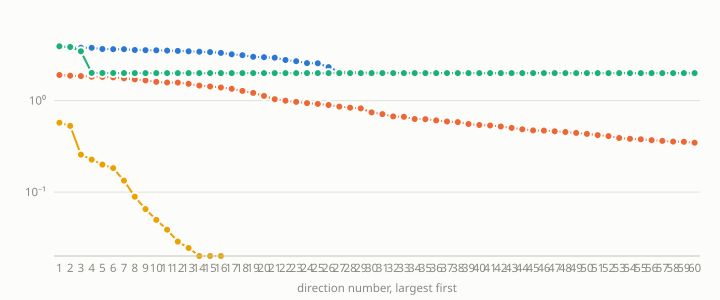

# Stage C report: the iterated spectral ladder on ManiSkill3 robot data (E24)

Design and limits: `docs/stage_c_design.md`. Encoder: frozen ImageNet-initialized ResNet-50 features (2048-d) plus an MLP head trained with the JEPA recipe (adjacent-frame prediction, variance and covariance regulariser, no viewpoint-invariance term), 128-d output, then the engine's whitening and spectral ladder. Rung 1 = viewpoint pairs (base vs side camera), rung 2 = trajectory pairs. Block sizes by the absolute-gap rule γ = 0.1 λ₁ (Stage A); if no gap qualifies the largest gap ratio among the first 32 is used and flagged.

## PickCube: 100 groups × 8 trajectories (6 train / 2 validation per group), 3 split seeds

**E24 for PickCube: NOT confirmed** (P1 viewpoint ratio ≥ 3: NO; P2 trajectory ratio ≥ 1.5: yes; P3 controls: yes; P4 camera decoding: NO; each must hold on every split seed).

| Quantity | Value (mean ± std over split seeds) |
|---|---|
| Block sizes chosen: rung 1 variant (viewpoint) / rung 2 variant (execution) | 26 / 29 / 13 / 26 / 19 / 26 (one pair per split seed) |
| Fallback used (no gap met the rule): rung 1 / rung 2 | True / True / True / True / True / True |
| Gap ratio at the chosen d: rung 1 / rung 2 | 1.11 ± 0.05 / 1.09 ± 0.03 |
| Rank monitor passes: rung 1 / rung 2 | 0/3 / 0/3 |
| P1: viewpoint pairs, response V1 / Q1 (paper two-block analogue 8.4×) | 1.37 ± 0.02 |
| P2: trajectory pairs, response V2 / Q2 (paper analogue 2.1×) | 1.74 ± 0.04 |
| Paper-style two-block ratio (V1+V2 against Q2): viewpoint pairs / trajectory pairs | 1.24 ± 0.04 / 1.41 ± 0.07 |
| Control: random split of the same sizes, viewpoint / trajectory ratio | 1.00 ± 0.00 / 1.01 ± 0.02 |
| Control: shuffled pairs, rung-1 gap ratio at d = 1 | 1.01 ± 0.00 |
| P4: camera decoded from V1 / from Q1 (chance 0.5) | 0.958 ± 0.036 / 0.612 ± 0.121 |
| Layout (initial cube xy + goal xyz) R² from core Q2 / from V1 / from V2 / from all features | 0.363 ± 0.016 / 0.231 ± 0.024 / 0.009 ± 0.004 / 0.374 ± 0.013 |
| Progress R² from core Q2 / from V2 | 0.469 ± 0.058 / 0.017 ± 0.011 |
| Current cube position R² from core Q2 | 0.702 ± 0.043 |

## PushCube: 100 groups × 8 trajectories (6 train / 2 validation per group), 3 split seeds

**E24 for PushCube: NOT confirmed** (P1 viewpoint ratio ≥ 3: NO; P2 trajectory ratio ≥ 1.5: NO; P3 controls: yes; P4 camera decoding: NO; each must hold on every split seed).

| Quantity | Value (mean ± std over split seeds) |
|---|---|
| Block sizes chosen: rung 1 variant (viewpoint) / rung 2 variant (execution) | 112 / 2 / 5 / 20 / 118 / 4 (one pair per split seed) |
| Fallback used (no gap met the rule): rung 1 / rung 2 | False / False / False / True / False / False |
| Gap ratio at the chosen d: rung 1 / rung 2 | 1.76 ± 0.78 / 1.51 ± 0.50 |
| Rank monitor passes: rung 1 / rung 2 | 0/3 / 0/3 |
| P1: viewpoint pairs, response V1 / Q1 (paper two-block analogue 14.0×) | 1.17 ± 0.16 |
| P2: trajectory pairs, response V2 / Q2 (paper analogue 3.1×) | 1.51 ± 0.50 |
| Paper-style two-block ratio (V1+V2 against Q2): viewpoint pairs / trajectory pairs | 1.11 ± 0.13 / 1.10 ± 0.74 |
| Control: random split of the same sizes, viewpoint / trajectory ratio | 1.01 ± 0.01 / 1.13 ± 0.19 |
| Control: shuffled pairs, rung-1 gap ratio at d = 1 | 1.01 ± 0.01 |
| P4: camera decoded from V1 / from Q1 (chance 0.5) | 0.996 ± 0.003 / 0.686 ± 0.074 |
| Layout (initial cube xy + goal xyz) R² from core Q2 / from V1 / from V2 / from all features | 0.121 ± 0.185 / 0.692 ± 0.303 / 0.002 ± 0.004 / 0.689 ± 0.319 |
| Progress R² from core Q2 / from V2 | 0.030 ± 0.033 / 0.004 ± 0.006 |
| Current cube position R² from core Q2 | 0.121 ± 0.193 |

*P2. Pair-difference spectra on the robot data, split seed 0. A cliff would show as a sharp drop; a smooth decay means no clean block boundary.*

## Limits
Simulated robot data generated here (ManiSkill motion-planning solutions with perturbed waypoints and speed; the paper's own way of generating trajectories is not stated); frozen ImageNet ResNet-50 plus a small trained head, not the paper's fine-tuned encoder; group count and frames per trajectory as stated per task above; the paper's behaviour-cloning and closed-loop results are out of scope.